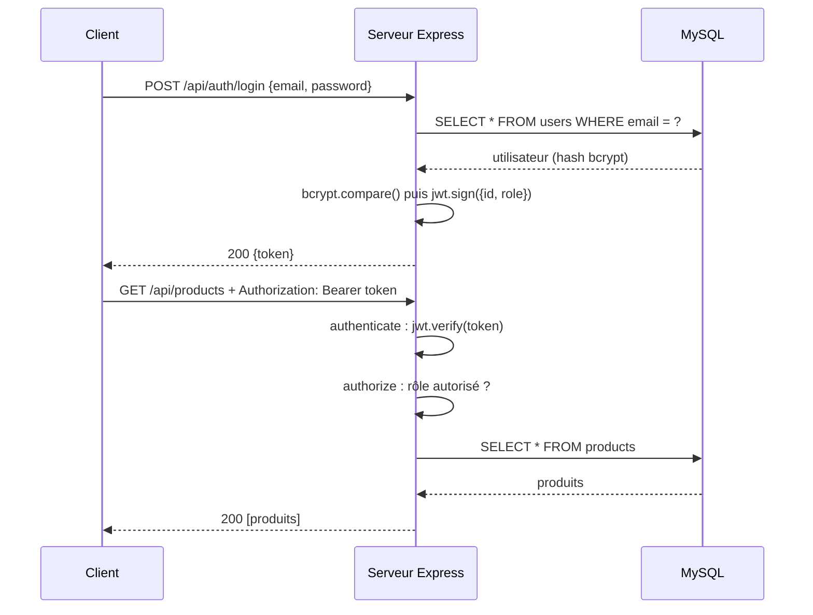
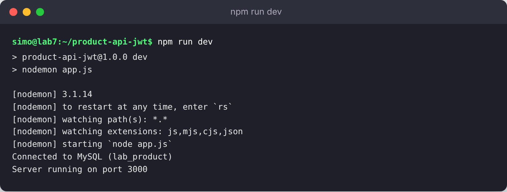
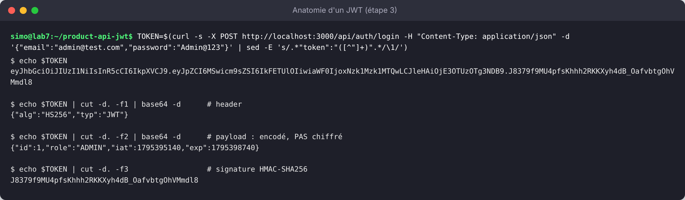
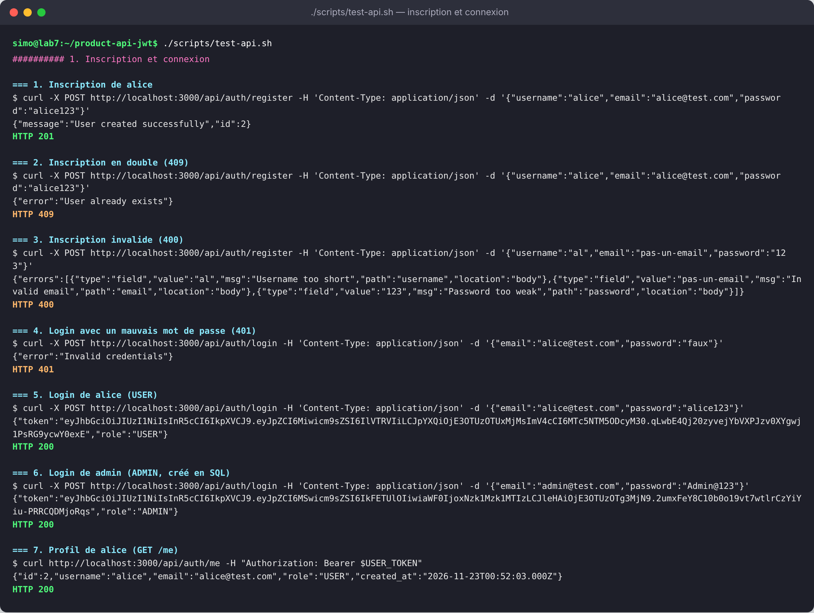
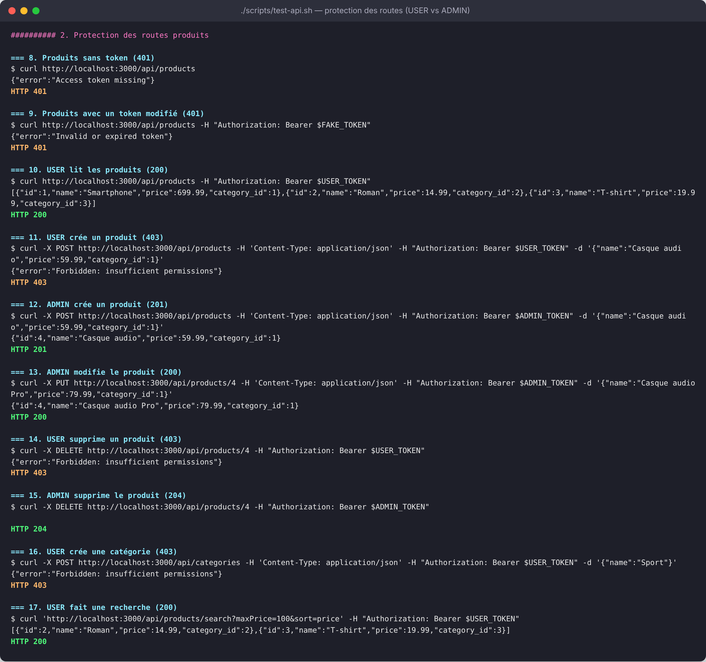
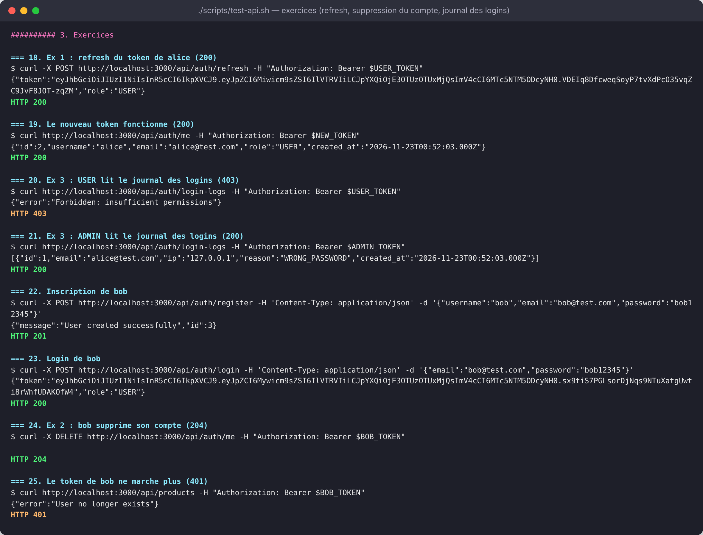
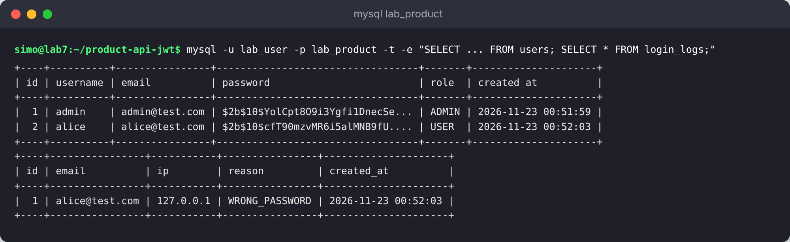
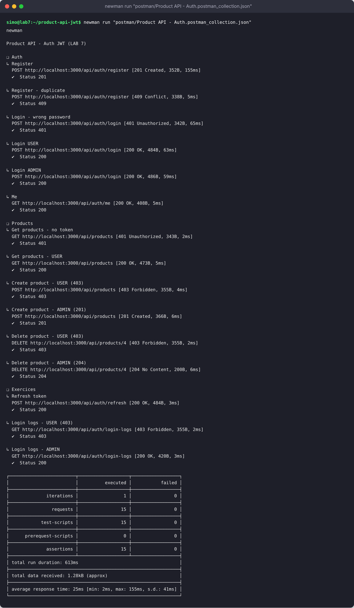

# LAB 7 – Authentification et autorisation avec JWT (Node.js / Express)

Suite du LAB 6 : l'API de produits (Node.js + MySQL) est maintenant sécurisée.

- inscription et connexion, avec des mots de passe hachés par **bcrypt** ;
- authentification **stateless** avec un **JWT** valable 1 h ;
- middleware `authenticate` (vérifie le token) et `authorize` (vérifie le rôle) ;
- rôles **USER** (lecture) et **ADMIN** (écriture) ;
- validation des données, CORS, gestion centralisée des erreurs ;
- les 3 exercices : refresh du token, suppression du compte, journal des connexions échouées.

Cours : *Développement Backend avec Java, Node.js et PHP* – MLIAEdu

---

## Technologies

| Outil | Rôle |
|---|---|
| Node.js (≥ 18), Express 5, modules ES (`"type": "module"`) | Serveur |
| mysql2 | Connexion MySQL (pool) |
| bcrypt | Hachage des mots de passe |
| jsonwebtoken | Création et vérification des JWT |
| express-validator | Validation |
| cors, dotenv | CORS et variables d'environnement |
| nodemon (dev) | Redémarrage automatique |

## Structure du projet

```
product-api-jwt/
├── app.js                          # point d'entrée
├── .env.example
├── sql/
│   ├── create_database.sql         # tables categories, products, users, login_logs
│   └── seed_data.sql               # données de test + compte ADMIN
├── postman/Product API - Auth.postman_collection.json
├── scripts/test-api.sh             # tests curl
├── docs/screenshots/
└── src/
    ├── config/db.js
    ├── utils/
    │   ├── password.js             # hashPassword / verifyPassword (bcrypt)
    │   └── token.js                # generateToken (JWT)
    ├── middleware/
    │   ├── auth.js                 # authenticate + authorize
    │   ├── validators.js
    │   └── errorHandler.js
    ├── controllers/                # authController, productController, categoryController
    ├── routes/                     # authRoutes, productRoutes, categoryRoutes
    ├── services/                   # repris du LAB 6
    └── repositories/               # repris du LAB 6
```

## Installation

### 1. Base de données

```bash
mysql -u lab_user -p < sql/create_database.sql
mysql -u lab_user -p < sql/seed_data.sql
```

Le script `seed_data.sql` crée aussi le compte administrateur (étape 18 : « créer un compte ADMIN via SQL direct ») :

| Email | Mot de passe | Rôle |
|---|---|---|
| admin@test.com | Admin@123 | ADMIN |

Le mot de passe est stocké sous forme de hash bcrypt, que j'ai généré avec `bcrypt.hash('Admin@123', 10)`.

### 2. Projet

```bash
git clone <url-du-repo>
cd product-api-jwt
npm install
cp .env.example .env
npm run dev
```

Dans `.env`, il faut remplacer `JWT_SECRET` par une vraie clé longue et aléatoire :

```bash
node -e "console.log(require('crypto').randomBytes(32).toString('hex'))"
```

Si `JWT_SECRET` est absent, l'application refuse de démarrer.

## Endpoints

### Authentification

| Méthode | Endpoint | Accès | Description |
|---|---|---|---|
| POST | `/api/auth/register` | public | Inscription `{username, email, password}` → toujours rôle USER |
| POST | `/api/auth/login` | public | Connexion `{email, password}` → `{token, role}` |
| GET | `/api/auth/me` | connecté | Profil de l'utilisateur (sans le mot de passe) |
| POST | `/api/auth/refresh` | connecté | **Ex. 1** : nouveau token |
| DELETE | `/api/auth/me` | connecté | **Ex. 2** : supprimer son compte |
| GET | `/api/auth/login-logs` | ADMIN | **Ex. 3** : connexions échouées |

### Produits et catégories

Toutes ces routes demandent un token (`Authorization: Bearer <token>`).

| Action | USER | ADMIN |
|---|:-:|:-:|
| `GET /api/products`, `/api/products/:id`, `/api/products/search` | ✅ | ✅ |
| `POST`, `PUT`, `DELETE /api/products` | ❌ 403 | ✅ |
| `GET /api/categories` | ✅ | ✅ |
| `POST`, `PUT`, `DELETE /api/categories` | ❌ 403 | ✅ |

Sans token, ou avec un token invalide ou expiré, on obtient **401**.

### Exemple

```bash
# 1. Connexion
curl -X POST http://localhost:3000/api/auth/login \
  -H "Content-Type: application/json" \
  -d '{"email":"admin@test.com","password":"Admin@123"}'
# {"token":"eyJhbGciOiJIUzI1NiIsInR5cCI6IkpXVCJ9...","role":"ADMIN"}

# 2. Requête protégée
curl http://localhost:3000/api/auth/me -H "Authorization: Bearer <TOKEN>"
```

## Fonctionnement

### Le JWT

Le token contient trois parties séparées par des points : `header.payload.signature`. Le payload contient `{ id, role, iat, exp }`. Il est seulement **encodé en Base64**, pas chiffré : n'importe qui peut le lire (voir la capture « Anatomie d'un JWT »). On n'y met donc jamais de mot de passe. C'est la **signature**, calculée avec `JWT_SECRET`, qui empêche de le modifier : si on change un seul caractère, `jwt.verify()` le refuse (test 9).

### Diagramme de séquence (étape 19)



Le serveur ne garde aucune session : à chaque requête, il vérifie seulement la signature du token.

### 401 ou 403 ?

- **401** : on ne sait pas qui fait la requête (pas de token, token faux, expiré, ou compte supprimé).
- **403** : on sait qui fait la requête, mais son rôle ne lui permet pas l'action (un USER qui veut créer un produit).

## Tests

```bash
# base réinitialisée + serveur lancé, puis :
./scripts/test-api.sh
```

Avec Postman : importer `postman/Product API - Auth.postman_collection.json` et lancer le **Runner**. Les requêtes « Login » enregistrent automatiquement le token dans les variables `userToken` et `adminToken`. En ligne de commande : `newman run "postman/Product API - Auth.postman_collection.json"`.

### Démarrage


### Anatomie d'un JWT (étape 3)


### Inscription et connexion


### Protection des routes : USER vs ADMIN


### Exercices


### Base de données : mots de passe hachés et journal des connexions


### Collection Postman (newman) : 15/15


## Exercices

1. **Refresh** (`POST /api/auth/refresh`) : à partir d'un token encore valide, renvoie un nouveau token valable 1 h. C'est une version simple. La vraie méthode utilise un *refresh token* séparé, de longue durée, stocké en base ou dans un cookie sécurisé (étape 4).
2. **Suppression du compte** (`DELETE /api/auth/me`) : supprime l'utilisateur connecté. Pour que son ancien token ne serve plus, `authenticate` vérifie que l'utilisateur existe toujours en base (test 25 → 401).
3. **Journal des logins échoués** : table `login_logs` (email, IP, raison : `UNKNOWN_EMAIL` ou `WRONG_PASSWORD`, date). Elle est consultable par l'ADMIN avec `GET /api/auth/login-logs`.

## Comparaison avec Spring Security (LAB 4)

| | Spring Security (LAB 4) | Node.js / Express (LAB 7) |
|---|---|---|
| Vérification du token | `JwtAuthenticationFilter` dans la `SecurityFilterChain` | middleware `authenticate` |
| Contrôle des rôles | `@PreAuthorize("hasRole('ADMIN')")` | middleware `authorize('ADMIN')` |
| Hachage | `BCryptPasswordEncoder` | `bcrypt.hash` / `bcrypt.compare` |
| Utilisateur connecté | `SecurityContextHolder` | `req.user` |
| Configuration | déclarative (beans, annotations) | manuelle, middleware par middleware |

Les idées sont les mêmes (authentification puis autorisation). En Node.js on écrit plus de code soi-même, mais on voit mieux ce qui se passe.

## Remarques et modifications par rapport à l'énoncé

- **Modules ES** : le LAB 6 utilisait `require`, et ce lab demande `"type": "module"`. J'ai donc converti tout le code en `import` / `export`.
- **Token invalide → 401** au lieu de 403. L'énoncé renvoie 403 dans `authenticate`, mais un token faux ou expiré veut dire « non authentifié ». 403 est réservé au cas d'un rôle insuffisant.
- **Pas de secret par défaut** : l'énoncé utilise `process.env.JWT_SECRET || 'secret_key_dev'`. Si on oublie le `.env`, n'importe qui connaissant cette valeur pourrait créer des tokens. Ici, l'application refuse de démarrer sans `JWT_SECRET`.
- **Configuration de la base** dans `.env` au lieu d'être écrite dans `db.js`. Le nom de la base reste `lab_product` (celui du LAB 6).
- **Inscription** : le rôle n'est jamais lu dans le body, sinon n'importe qui pourrait s'inscrire en ADMIN.
- **Login** : validation ajoutée (email valide, mot de passe obligatoire), et le même message est renvoyé que ce soit l'email ou le mot de passe qui est faux.
- **`authenticate`** relit le rôle en base : un compte supprimé ou dont le rôle a changé est pris en compte tout de suite, sans attendre l'expiration du token.
- **Express 5** transmet automatiquement les erreurs des fonctions `async` au middleware d'erreur, donc les controllers n'ont plus besoin de `try/catch`.
- Les catégories sont protégées de la même façon que les produits.

## Ce que j'ai appris

- La différence entre authentification et autorisation, et entre 401 et 403.
- Comment est construit un JWT, et pourquoi le payload n'est pas secret.
- Hacher et vérifier un mot de passe avec bcrypt.
- Écrire des middlewares Express (`authenticate`, `authorize`) et les appliquer à un routeur.

**Pour aller plus loin :** vrais refresh tokens stockés en base, `express-rate-limit` sur le login contre le brute force, HTTPS en production.
